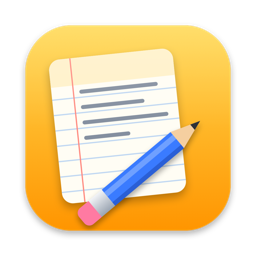
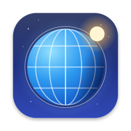
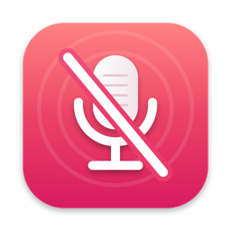
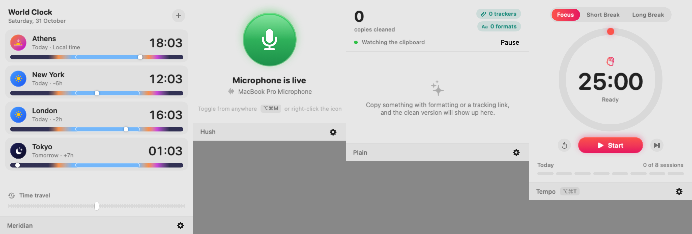

# Small Mac apps

Five small, native menu bar apps for macOS. Each does one thing, stays out of the way, and looks like it belongs on a Mac.

<p>
    
</p>



| App | What it does | Shortcut |
|---|---|---|
| **Jot** | A scratchpad in the menu bar with several pages. Saves as you type. | ⌥⌘J opens it, ⌘N new page, ⌘[ and ⌘] switch pages |
| **Meridian** | World clocks with a day and night band for every city, and a time travel slider for planning across time zones. Pin one city's time to the menu bar. | |
| **Hush** | Mutes the microphone from anywhere, with an on-screen overlay like the volume HUD. Falls back to input volume on devices without a mute control. | ⌥⌘M, or right-click the icon |
| **Plain** | Cleans text as you copy it: removes formatting, removes tracking parameters from links (`utm_*`, `fbclid`, `gclid`, `si` on YouTube and Spotify, and more), trims spaces. Skips anything a password manager marks as concealed. | |
| **Tempo** | A focus timer: 25 minute sessions, short and long breaks, a daily goal, the countdown in the menu bar and a notification at the end. | ⌥⌘T start or pause, or right-click the icon |

Every app has launch at login in its gear menu. Global shortcuts use Carbon hot keys, so none of them needs Accessibility permission. None of them talks to the network.

## Requirements

- macOS 14 or later
- Xcode 16 or later (Swift 5.10 tools; built and tested with Xcode 27.2 on macOS 27)

## Build and install

```bash
# HTTPS (no SSH key required):
git clone https://github.com/weirdapps/macapps.git
# or, with SSH:
git clone git@github.com:weirdapps/macapps.git
cd macapps
scripts/build.sh            # builds signed bundles into build/
scripts/build.sh --install  # and copies them to /Applications
swift test                  # link cleaner tests
```

The bundles are signed ad hoc. For distribution outside your own Mac they need a Developer ID signature and notarization.

## Layout

| Path | What is there |
|---|---|
| `Sources/Kit/` | Shared code: menu bar popover, global hot keys, HUD overlay, launch at login, panel footer, JSON storage, link cleaner |
| `Sources/<App>/main.swift` | One file per app: model and SwiftUI views |
| `Apps/<App>/Info.plist` | Bundle metadata (`LSUIElement`, so no Dock icon) |
| `Tools/IconGen/` | Draws every app icon in Core Graphics, no image assets |
| `scripts/build.sh` | Builds, wraps each binary in an `.app`, makes the `.icns`, signs, installs |

`<App> --snapshot out.png` renders an app's panel to a PNG and quits, for screenshots.
