<p align="center">
  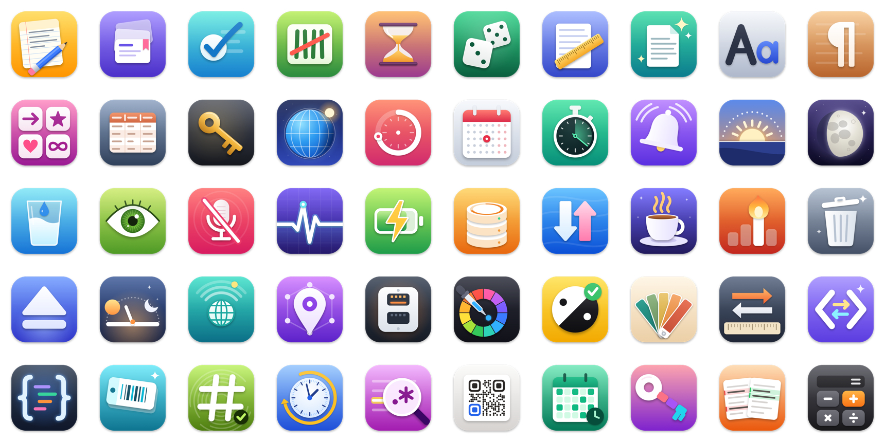
</p>

<h1 align="center">Useful Mac Apps</h1>

<p align="center">
  A hundred native apps for macOS: fifty for the menu bar, fifty for the desktop.<br>
  Each does one thing and looks like it belongs on a Mac.
</p>

<p align="center">
  <a href="https://weirdapps.github.io/macapps/"><b>Website</b></a> ·
  <a href="https://github.com/weirdapps/macapps/releases/latest"><b>Download</b></a> ·
  <a href="#build-from-source"><b>Build from source</b></a>
</p>

<p align="center">
  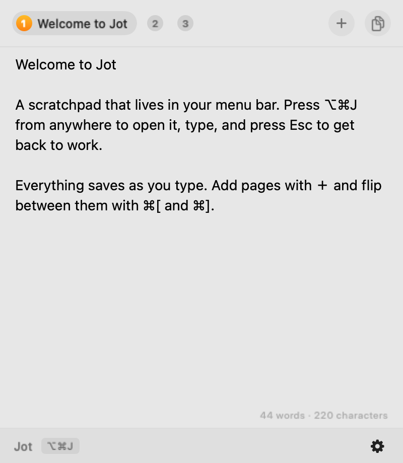
  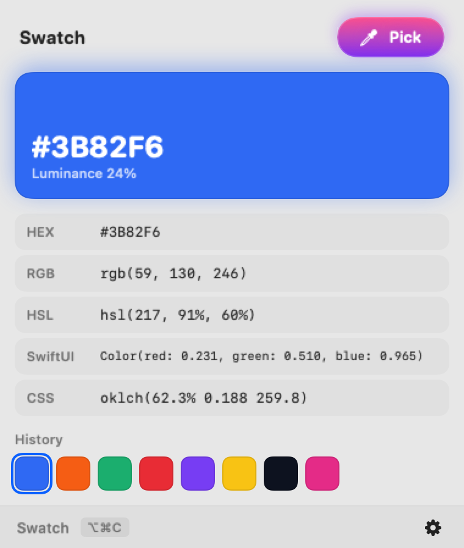
  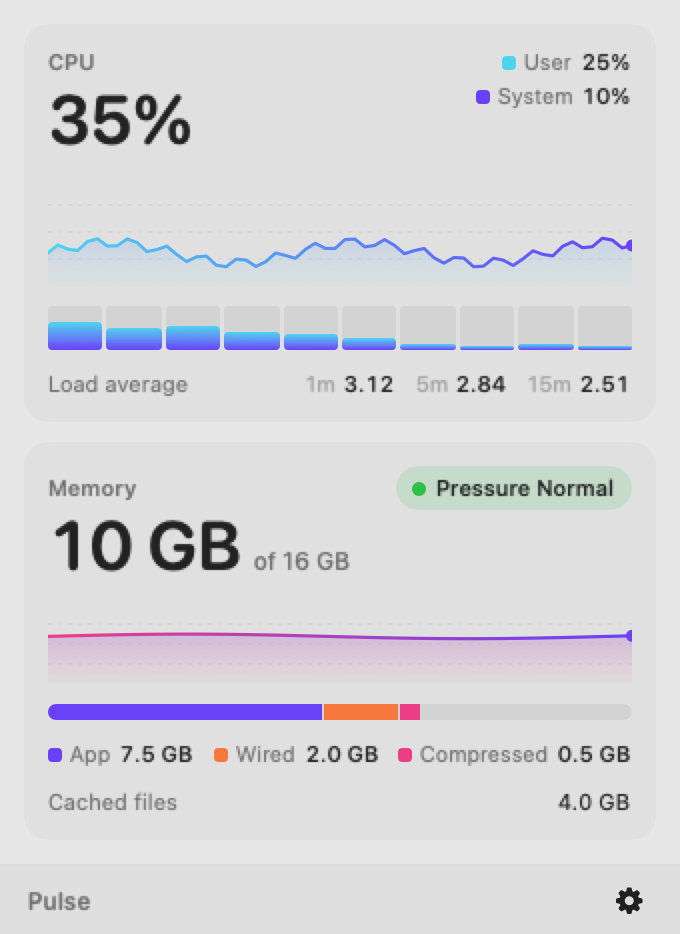
</p>

<p align="center">
  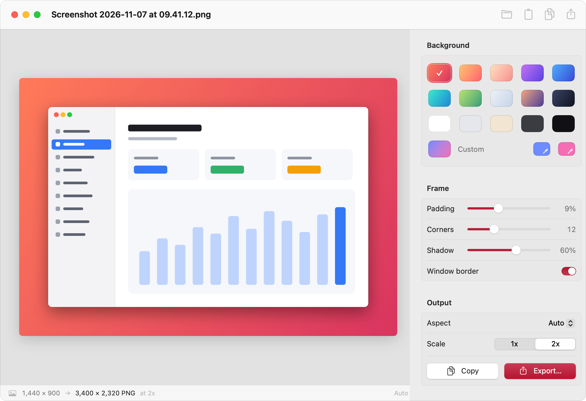
</p>

## Why

- **Native.** AppKit and SwiftUI, no web views, no Electron, no third-party packages. Each app is a few hundred kilobytes to a few megabytes and idles at zero CPU.
- **Private.** No accounts, no analytics, no telemetry. Data stays in `~/Library/Application Support/<App>`.
- **No scary permissions.** No Accessibility, Screen Recording or Automation. Global shortcuts use Carbon hot keys. Bin is the one exception: reading the Trash needs Full Disk Access, and it tells you how to grant it. Hush and Tune use the microphone, because that is their job.
- **Out of the way.** Menu bar apps have no Dock icon and no windows: click the icon in the menu bar, or press its shortcut.
- **At home on a Mac.** Desktop apps have a real main menu with shortcuts, toolbars, drag and drop from Finder, undo, and light and dark mode.

## Menu bar apps

### Write and organise

| | App | What it does | Shortcut |
|---|---|---|---|
|  | [**Jot**](https://weirdapps.github.io/macapps/#jot) | A scratchpad in your menu bar | ⌥⌘J |
| 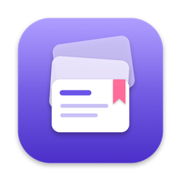 | [**Stash**](https://weirdapps.github.io/macapps/#stash) | Text snippets one click away | ⌥⌘S |
| 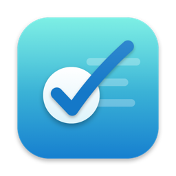 | [**Ticks**](https://weirdapps.github.io/macapps/#ticks) | A quick checklist in your menu bar |  |
| 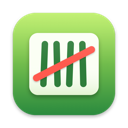 | [**Tally**](https://weirdapps.github.io/macapps/#tally) | Counters for anything, in your menu bar |  |
| 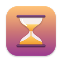 | [**Until**](https://weirdapps.github.io/macapps/#until) | Countdowns to the days that matter |  |
| 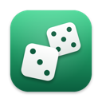 | [**Decide**](https://weirdapps.github.io/macapps/#decide) | Coin flips, dice and picks for when you cannot choose |  |
| 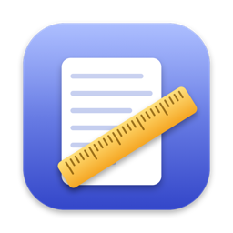 | [**Measure**](https://weirdapps.github.io/macapps/#measure) | Word counts and reading time for copied text |  |

### Clipboard and text

| | App | What it does | Shortcut |
|---|---|---|---|
| 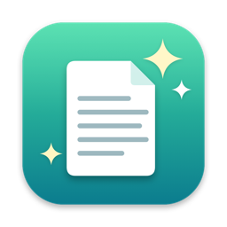 | [**Plain**](https://weirdapps.github.io/macapps/#plain) | Clean clipboard text and links |  |
|  | [**Case**](https://weirdapps.github.io/macapps/#case) | Change the case of copied text |  |
| 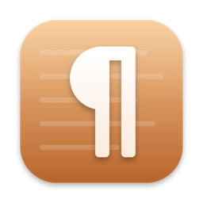 | [**Lorem**](https://weirdapps.github.io/macapps/#lorem) | Placeholder text and fake data on tap |  |
| 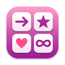 | [**Glyphs**](https://weirdapps.github.io/macapps/#glyphs) | Special characters a click away | ⌥⌘G |
| 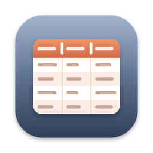 | [**Tabula**](https://weirdapps.github.io/macapps/#tabula) | Turn copied CSV into Markdown tables and back |  |
| 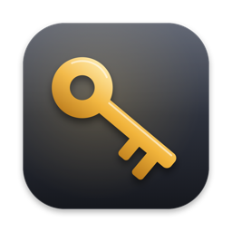 | [**Keymaker**](https://weirdapps.github.io/macapps/#keymaker) | Strong passwords and passphrases on demand |  |

### Time and focus

| | App | What it does | Shortcut |
|---|---|---|---|
| 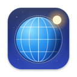 | [**Meridian**](https://weirdapps.github.io/macapps/#meridian) | World clocks in your menu bar |  |
| 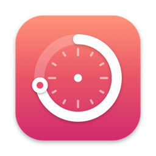 | [**Tempo**](https://weirdapps.github.io/macapps/#tempo) | A focus timer in your menu bar | ⌥⌘T |
|  | [**Month**](https://weirdapps.github.io/macapps/#month) | A calendar with week numbers in your menu bar |  |
| 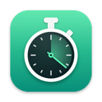 | [**Lap**](https://weirdapps.github.io/macapps/#lap) | A stopwatch with laps in your menu bar |  |
| 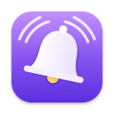 | [**Nudge**](https://weirdapps.github.io/macapps/#nudge) | Quick reminders from your menu bar | ⌥⌘R |
| 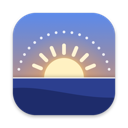 | [**Daylight**](https://weirdapps.github.io/macapps/#daylight) | Sunrise, sunset and golden hour in your menu bar |  |
| 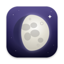 | [**Luna**](https://weirdapps.github.io/macapps/#luna) | The moon phase in your menu bar |  |

### Wellbeing

| | App | What it does | Shortcut |
|---|---|---|---|
| 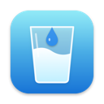 | [**Sip**](https://weirdapps.github.io/macapps/#sip) | Hydration tracking in your menu bar |  |
| 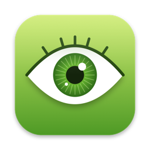 | [**Blink**](https://weirdapps.github.io/macapps/#blink) | Eye breaks, the 20-20-20 way |  |
| 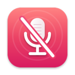 | [**Hush**](https://weirdapps.github.io/macapps/#hush) | Mute your microphone from anywhere | ⌥⌘M |

### System

| | App | What it does | Shortcut |
|---|---|---|---|
| 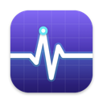 | [**Pulse**](https://weirdapps.github.io/macapps/#pulse) | CPU and memory at a glance |  |
| 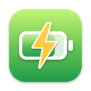 | [**Charge**](https://weirdapps.github.io/macapps/#charge) | Your battery, in detail |  |
| 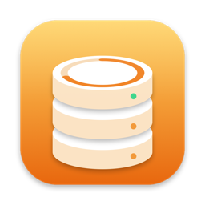 | [**Room**](https://weirdapps.github.io/macapps/#room) | Disk space for every volume |  |
| 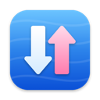 | [**Flow**](https://weirdapps.github.io/macapps/#flow) | Network speed in your menu bar |  |
| 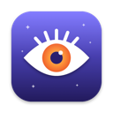 | [**Awake**](https://weirdapps.github.io/macapps/#awake) | Keep your Mac awake | ⌥⌘A |
| 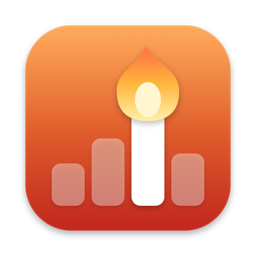 | [**Hogs**](https://weirdapps.github.io/macapps/#hogs) | What is eating your CPU and memory |  |
| 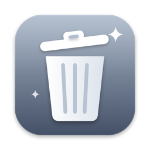 | [**Bin**](https://weirdapps.github.io/macapps/#bin) | How full is the Trash |  |
| 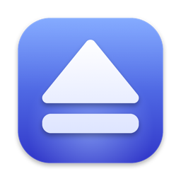 | [**Eject**](https://weirdapps.github.io/macapps/#eject) | Eject every disk in one go | ⌥⌘E |
| 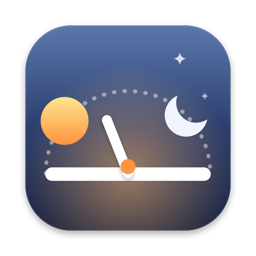 | [**Since**](https://weirdapps.github.io/macapps/#since) | Uptime, sleep and wake, at a glance |  |

### Network

| | App | What it does | Shortcut |
|---|---|---|---|
| 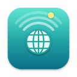 | [**Reach**](https://weirdapps.github.io/macapps/#reach) | Is the internet up, and how fast |  |
| 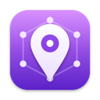 | [**Address**](https://weirdapps.github.io/macapps/#address) | Every IP address, one click to copy |  |
| 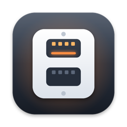 | [**Ports**](https://weirdapps.github.io/macapps/#ports) | Who is listening on which port |  |

### Colour and design

| | App | What it does | Shortcut |
|---|---|---|---|
| 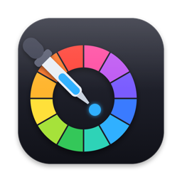 | [**Swatch**](https://weirdapps.github.io/macapps/#swatch) | A colour picker in your menu bar | ⌥⌘C |
| 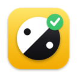 | [**Contrast**](https://weirdapps.github.io/macapps/#contrast) | A WCAG contrast checker in your menu bar |  |
| 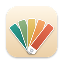 | [**Palette**](https://weirdapps.github.io/macapps/#palette) | Colour palettes from one colour, in your menu bar |  |
| 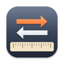 | [**Convert**](https://weirdapps.github.io/macapps/#convert) | A unit converter in your menu bar |  |

### Developer tools

| | App | What it does | Shortcut |
|---|---|---|---|
| 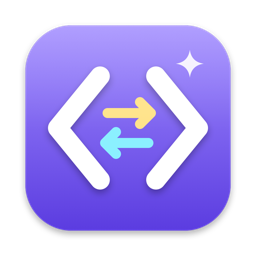 | [**Codec**](https://weirdapps.github.io/macapps/#codec) | Encode and decode text in your menu bar |  |
| 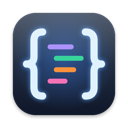 | [**Pretty**](https://weirdapps.github.io/macapps/#pretty) | Format and validate JSON from your menu bar | ⌥⌘F |
| 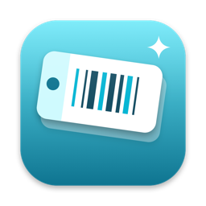 | [**Ident**](https://weirdapps.github.io/macapps/#ident) | Generate UUIDs, ULIDs and random IDs |  |
| 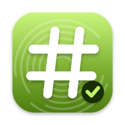 | [**Hash**](https://weirdapps.github.io/macapps/#hash) | Hash text and files, and check them |  |
| 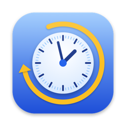 | [**Epoch**](https://weirdapps.github.io/macapps/#epoch) | Convert Unix timestamps and dates |  |
| 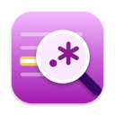 | [**Regex**](https://weirdapps.github.io/macapps/#regex) | Test regular expressions live |  |
|  | [**Square**](https://weirdapps.github.io/macapps/#square) | Make and read QR codes |  |
|  | [**Cron**](https://weirdapps.github.io/macapps/#cron) | Explain cron schedules and their next runs |  |
| 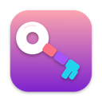 | [**Token**](https://weirdapps.github.io/macapps/#token) | Decode and verify JSON Web Tokens |  |
| 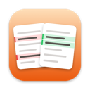 | [**Compare**](https://weirdapps.github.io/macapps/#compare) | Compare two texts line by line |  |
| 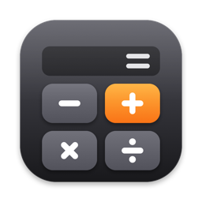 | [**Sum**](https://weirdapps.github.io/macapps/#sum) | A calculator in your menu bar | ⌥⌘K |

## Desktop apps

<p align="center"></p>

Windowed apps with a Dock icon, a full menu bar, keyboard shortcuts, drag and drop, undo and dark mode.

### Images

| | App | What it does |
|---|---|---|
|  | [**Shrink**](https://weirdapps.github.io/macapps/#shrink) | Resize and compress images in batches |
|  | [**Scrub**](https://weirdapps.github.io/macapps/#scrub) | See and remove the metadata hidden in your photos |
|  | [**Mat**](https://weirdapps.github.io/macapps/#mat) | Put screenshots on a beautiful background |
|  | [**Iconsmith**](https://weirdapps.github.io/macapps/#iconsmith) | Turn any image into a Mac app icon |
|  | [**Pixel**](https://weirdapps.github.io/macapps/#pixel) | A tiny pixel art editor |
|  | [**Loop**](https://weirdapps.github.io/macapps/#loop) | Make animated GIFs from video or images |
|  | [**Arrow**](https://weirdapps.github.io/macapps/#arrow) | Mark up screenshots with arrows, boxes and text |
|  | [**Hues**](https://weirdapps.github.io/macapps/#hues) | Pull a colour palette from any image |

### Documents and writing

| | App | What it does |
|---|---|---|
|  | [**Binder**](https://weirdapps.github.io/macapps/#binder) | Merge, split and reorder PDF pages |
|  | [**Invoice**](https://weirdapps.github.io/macapps/#invoice) | Clean PDF invoices in a minute |
|  | [**Mark**](https://weirdapps.github.io/macapps/#mark) | Write Markdown with a live native preview |
|  | [**Draft**](https://weirdapps.github.io/macapps/#draft) | Distraction-free writing with a word goal |
|  | [**Grid**](https://weirdapps.github.io/macapps/#grid) | Open big CSV files, sort and filter them |
|  | [**Specimen**](https://weirdapps.github.io/macapps/#specimen) | Preview every font with your own text |

### Organise

| | App | What it does |
|---|---|---|
|  | [**Board**](https://weirdapps.github.io/macapps/#board) | A simple kanban board |
|  | [**Streak**](https://weirdapps.github.io/macapps/#streak) | Track daily habits on a calendar grid |
|  | [**Diary**](https://weirdapps.github.io/macapps/#diary) | A private daily journal |
|  | [**Recall**](https://weirdapps.github.io/macapps/#recall) | Flashcards with spaced repetition |
|  | [**Hours**](https://weirdapps.github.io/macapps/#hours) | Track time per project and export timesheets |
|  | [**Split**](https://weirdapps.github.io/macapps/#split) | Share expenses with friends and settle up |
|  | [**Cue**](https://weirdapps.github.io/macapps/#cue) | A teleprompter for talks and videos |
|  | [**Mind**](https://weirdapps.github.io/macapps/#mind) | Mind maps you can build with the keyboard |

### Files and developer

| | App | What it does |
|---|---|---|
|  | [**Rename**](https://weirdapps.github.io/macapps/#rename) | Rename files in bulk with a live preview |
|  | [**Twins**](https://weirdapps.github.io/macapps/#twins) | Find duplicate files and free up space |
|  | [**Heft**](https://weirdapps.github.io/macapps/#heft) | See what fills a folder |
|  | [**Tail**](https://weirdapps.github.io/macapps/#tail) | Follow log files as they grow |
|  | [**Lite**](https://weirdapps.github.io/macapps/#lite) | Browse SQLite databases |
|  | [**Plist**](https://weirdapps.github.io/macapps/#plist) | View and edit property lists |
|  | [**Hex**](https://weirdapps.github.io/macapps/#hex) | A hex viewer for any file |
|  | [**Request**](https://weirdapps.github.io/macapps/#request) | A tiny HTTP client |
|  | [**Canopy**](https://weirdapps.github.io/macapps/#canopy) | Explore big JSON files as a tree |

### Numbers and science

| | App | What it does |
|---|---|---|
|  | [**Figure**](https://weirdapps.github.io/macapps/#figure) | A notepad that calculates as you type |
|  | [**Plot**](https://weirdapps.github.io/macapps/#plot) | Paste numbers, get a chart |
|  | [**Curve**](https://weirdapps.github.io/macapps/#curve) | Plot functions and explore them |
|  | [**Loan**](https://weirdapps.github.io/macapps/#loan) | Loans and savings, worked out |
|  | [**Elements**](https://weirdapps.github.io/macapps/#elements) | An interactive periodic table |
|  | [**Life**](https://weirdapps.github.io/macapps/#life) | Conway's Game of Life, beautifully |

### Sound and video

| | App | What it does |
|---|---|---|
|  | [**Beat**](https://weirdapps.github.io/macapps/#beat) | A metronome that keeps perfect time |
|  | [**Tune**](https://weirdapps.github.io/macapps/#tune) | Tune your instrument with the microphone |
|  | [**Hum**](https://weirdapps.github.io/macapps/#hum) | Background noise for focus and sleep |
|  | [**Ivory**](https://weirdapps.github.io/macapps/#ivory) | A piano you play with your keyboard |
|  | [**Trim**](https://weirdapps.github.io/macapps/#trim) | Trim audio and video without re-encoding |

### Design

| | App | What it does |
|---|---|---|
|  | [**Sight**](https://weirdapps.github.io/macapps/#sight) | See your designs as people with colour blindness do |
|  | [**Blend**](https://weirdapps.github.io/macapps/#blend) | Design gradients and export them anywhere |

### Wellbeing and play

| | App | What it does |
|---|---|---|
|  | [**Exhale**](https://weirdapps.github.io/macapps/#exhale) | Guided breathing in a calm window |
|  | [**Typist**](https://weirdapps.github.io/macapps/#typist) | Practise touch typing and track your speed |
|  | [**Score**](https://weirdapps.github.io/macapps/#score) | Keep score for board and card games |
|  | [**Nine**](https://weirdapps.github.io/macapps/#nine) | Sudoku, calm and clean |
|  | [**Patience**](https://weirdapps.github.io/macapps/#patience) | Classic Klondike solitaire |
|  | [**Reversi**](https://weirdapps.github.io/macapps/#reversi) | The classic disc-flipping strategy game |

## Good to know

Every app has launch at login in its gear menu. Global shortcuts use Carbon hot keys, so none of them needs Accessibility permission. Only Reach (a HEAD request every 10 s to a URL you choose), Address (your public IP, fetched when you open it) and Request (an HTTP client: it sends what you tell it to) use the network.

## Install

1. Download `SmallMacApps.zip` (all fifty menu bar apps), `MacDesktopApps.zip` (all fifty desktop apps) or a single app's zip from the [latest release](https://github.com/weirdapps/macapps/releases/latest).
2. Unzip and drag the apps you want to `/Applications`.
3. The apps are signed ad hoc, not notarized, so macOS blocks them on first launch. Clear the quarantine flag once:

   ```bash
   xattr -dr com.apple.quarantine /Applications/Jot.app   # or each app you installed
   ```

   Or open the app, then click **Open Anyway** in System Settings › Privacy & Security.

Requires macOS 14 Sonoma or later on Apple silicon.

## Build from source

Needs Xcode 16 or later (Swift 5.10 tools). Built and tested with Xcode 27.2 on macOS 27.

```bash
# HTTPS (no SSH key required):
git clone https://github.com/weirdapps/macapps.git
# or, with SSH:
git clone git@github.com:weirdapps/macapps.git
cd macapps
scripts/build.sh                 # every app as a signed bundle in build/
scripts/build.sh --install       # and copies them to /Applications
scripts/build.sh --install Jot   # one app
swift test                       # Kit tests
scripts/selftest.sh              # desktop app self-tests (after build.sh)
scripts/release.sh               # release zips, website icons and screenshots
```

## How it is built

| Path | What is there |
|---|---|
| `Sources/Kit/` | Shared code: menu bar popover with a hidden Edit menu, global hot keys, HUD overlay, launch at login, panel footer, JSON storage, link cleaner, and for desktop apps window snapshots, the Help menu and a drop zone |
| `Sources/<App>/` | One app: model, SwiftUI views and `appIcon()`, drawn in Core Graphics with no image assets |
| `Apps/<App>/Info.plist` | Bundle metadata (`LSUIElement` for menu bar apps, so no Dock icon) |
| `scripts/build.sh` | Builds, wraps each binary in an `.app`, makes the `.icns`, signs, installs |
| `scripts/release.sh` | Zips every bundle for a release and refreshes `docs/` |
| `docs/` | The [website](https://weirdapps.github.io/macapps/), served by GitHub Pages |

`<App> --snapshot out.png` renders an app's panel or window to a PNG with fixed demo data, `<App> --icon out.png` renders its icon, and desktop apps run their logic checks with `<App> --selftest`. To add an app, read [docs/APP_GUIDE.md](docs/APP_GUIDE.md) (menu bar) or [docs/DESKTOP_GUIDE.md](docs/DESKTOP_GUIDE.md) (desktop).

## License

MIT © 2026 Dimitrios Plessas
